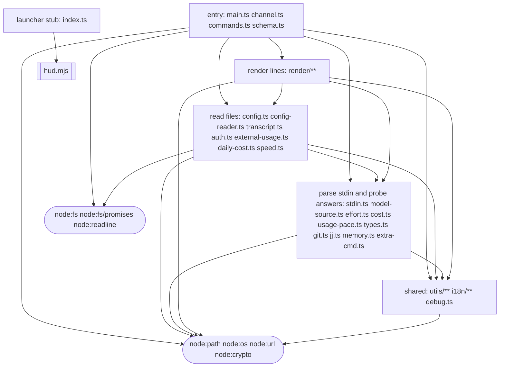

# Context Lens 架构

Claude Code 将状态栏数据传给 `hud.mjs`。启动进程使用已有采集逻辑把会话标识、模型和计数写入本项目的数据目录。默认静默采集，启用 `display.showTerminal` 后才启动终端渲染进程。

终端渲染器运行在启用 Node.js 权限控制的独立进程。`collector.mjs` 确定可读路径，执行 Git、jj 和内存探测，并将结果交给 `src/main.ts`。渲染器写入插件的 `data/` 目录。`fence.mjs` 限制模块导入，`hud.mjs` 过滤输出到终端的控制序列。`dist/index.js` 和 `src/index.ts` 保持现有启动器入口兼容。

`src/lens/` 提供桌面端、命令行和扩展 HUD 共用的会话数据。该后端及其路径工具 `src/claude-config-dir.ts` 独立于终端渲染进程。应用的构建和发布按本项目 GitHub Actions 配置执行。

## 终端渲染模块依赖

`verify/arch.check.mjs` 根据下图检查终端渲染代码的模块依赖及允许导入的 Node.js 内置模块。

